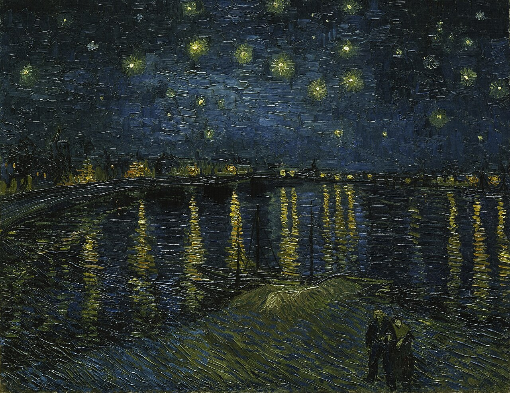

# Deep Learning — Classification & Exploration d'oeuvres d'Art




Projet de Deep Learning (M2) dédié à la classification de styles artistiques et à l'exploration sémantique d'oeuvres d'art à travers leurs représentations latentes, intégrant un serveur **MCP (Model Context Protocol)**.

Le pipeline s'appuie sur une taxonomie regroupant les styles en **21 mouvements artistiques** majeurs (Renaissance, Baroque, Impressionnisme, Cubisme, etc.) et extrait des embeddings 512D pour la recherche d'analogies visuelles.

---

## 1. Installation de l'environnement

### Prérequis
- Git & Git LFS (`git lfs install`)
- Python 3.10+ (testé avec Python 3.12 / 3.14)
- Carte graphique NVIDIA recommandée avec pilotes CUDA à jour

### Cloner le projet (avec Git LFS)
```bash
# Cloner le dépôt et récupérer les fichiers LFS (modèle et index)
git clone <url_du_repo> project
cd project
git lfs pull
```

### Création du venv
```bash
# Créer et activer l'environnement virtuel
python3 -m venv .venv
source .venv/bin/activate
```

### Installation des dépendances
```bash
# Dépendances de base (PyTorch, Torchvision, Pillow)
pip install -r requirements.txt

# Si vous disposez d'un GPU NVIDIA (CUDA 12.1+), installez la version GPU de PyTorch :
# pip install torch torchvision --index-url https://download.pytorch.org/whl/cu121

# Dépendances pour le serveur MCP et les outils d'indexation
pip install "mcp>=2.3.0" tqdm
```

---

## 2. Téléchargement & Préparation du dataset (ART500K)

Le projet utilise le dataset **[ART500K](https://deepart.hkust.edu.hk/ART500K/art500k.html)** (~500 000 images d'oeuvres d'art et leurs métadonnées).

> **Note :** Choisissez "Raw images of visual arts with general label list: Data&Labels(56.6GB)/Labels".

### Structure attendue dans `data/`
Après extraction, le dossier `data/` doit avoir l'arborescence suivante :

```text
data/
├── Art Movement/          # Dossiers par mouvements (utilisé pour l'entraînement canonique)
├── Artists1/              # oeuvres classées par artistes (partie 1)
├── Artists2/              # oeuvres classées par artistes (partie 2)
├── Medium/                # oeuvres classées par médium/support
├── label_list.csv         # Table de métadonnées (titres, artistes, styles, chemins)
├── head_info.csv          # En-têtes des colonnes de label_list.csv
└── Readme
```

### Extraction de l'archive
Si vous disposez de l'archive `art500k.tar.gz` (téléchargement ou support externe) :
```bash
mkdir -p data
tar -xzf art500k.tar.gz -C data/
```

> **Note :** Le chargeur de données (`src/loader.py`) filtre et associe automatiquement les sous-dossiers de `data/Art Movement/` aux 21 classes canoniques sans conflit d'étiquetage.

> **Note encore :** Nous n'utilisons pas le dossier Artists1 car il n'y a quasiment pas d'informations sur le genre. Nous aurions pu cependant intégrer Artists2 mais cela ajoute des problèmatiques d'équilibrage et représentation des classes, en plus d'allonger le temps d'entrainement. Nous nous reservons le droit d'intégrer les données, de poursuivre l'entrainement et d'améliorer les models pour la V2.

---

## 3. Entraînement & Évaluation

### Modèles disponibles
- **`ArtClassifierTinyBased`** : Backbone ConvNeXt-Tiny pré-entraîné + espace latent 512D + classifieur linéaire (modèle par défaut, excellent compromis vitesse/précision).
- **`ArtClassifier`** : Backbone ResNet-50 pré-entraîné + espace latent 512D.
- **`CustomArtCNN`** : CNN personnalisé à 4 blocs convolutifs entraîné *from scratch*.

### Lancer un entraînement simple
```bash
python3 src/trainer.py
```
Les checkpoints et l'historique sont enregistrés dans le dossier `checkpoints/` :
- `best_model.pth` : meilleur modèle selon la micro-précision Top-1.
- `best_loss_model.pth` : meilleur modèle selon la perte de validation.
- `latest_model.pth` : dernier état sauvegardé.
- `history.json` : métriques d'entraînement et de validation par époque.

### Lancer la campagne de mesures & benchmarks
Pour évaluer différentes combinaisons (architectures, stratégies d'early stopping, nombre d'époques) :
```bash
python3 src/measures.py
```

### Évaluation finale sur le jeu de test (10% inédit — 1 663 images)
Calcule l'ensemble des métriques d'évaluation (Micro/Macro Top-1, Top-5, Macro ROC-AUC OvR, mAP, rapport par classe) :
```bash
python3 src/evaluate_test.py
```

### Validation croisée stratifiée (3 plis) & Étude d'ablation
```bash
# Lancer la validation croisée stratifiée à 3 plis
python3 src/cross_validation.py

# Lancer l'étude d'ablation systématique (Backbone gelé, sans BatchNorm, sans Dropout, sans espace latent)
python3 src/ablation.py
```

### Explicabilité & Vérification de l'absence de raccourcis (Grad-CAM)
Génère les cartes thermiques d'attribution sur le dernier bloc de ConvNeXt-Tiny (`features[7][-1]`) :
```bash
python3 src/gradcam.py
```

### Génération de l'ensemble des graphiques du rapport (dégradé bleu pastel)
Régénère l'ensemble des figures du rapport (`rapports/*.png`) avec la palette unifiée bleu pastel :
```bash
python3 src/generate_plots.py
```

---

## 4. Serveur MCP (Model Context Protocol) & Assistant

Le serveur MCP (`src/serv_mcp/`) permet à un assistant IA (Claude Desktop, Cursor, Antigravity, Gemini) d'interagir directement avec notre réseau spécialiste ConvNeXt-Tiny.

### Étape 1 : Construire l'index de la galerie d'oeuvres
Avant de démarrer le serveur, extrayez les représentations latentes des oeuvres du jeu de validation :
```bash
python3 -m src.serv_mcp.build_index
```
Cette commande génère le fichier `checkpoints/gallery_index.pt`.

### Étape 2 : Évaluation de la recherche par similarité (Precision@k)
Mesure la pertinence stylistique des voisins retournés dans la galerie (Precision@1, Precision@3, Precision@5, Precision@10) :
```bash
python3 src/evaluate_mcp.py
```

### Étape 3 : Benchmark automatisé de l'assistant (20 requêtes types)
Exécute le banc d'essai complet testant les appels directs, l'enchaînement d'outils (*tool chaining*) et la robustesse aux erreurs :
```bash
python3 -m src.serv_mcp.bench_assistant
```

### Étape 4 : Lancer le serveur MCP
```bash
python3 -m src.serv_mcp.mcp_server
```

### Outils disponibles via MCP
| Outil | Paramètres | Description |
|---|---|---|
| `predict_style` | `image_path_or_id: str` | Prédit le style artistique d'une image locale, d'une URL ou d'un identifiant (Top 5 des styles, score de confiance, métadonnées). |
| `find_similar_artworks` | `image_path_or_id: str`, `k: int = 5` | Trouve les $k$ oeuvres les plus proches visuellement par **similarité cosinus** dans l'espace latent 512D (score entre -1.0 et 1.0). |
| `find_cross_style_neighbors` | `image_path_or_id: str`, `k: int = 5` | Trouve des oeuvres visuellement proches mais issues d'un **style différent** (exclut le style réel ou prédit pour une image externe). |
| `get_model_info` | *Aucun* | Fournit les détails techniques du modèle en mémoire (ConvNeXt-Tiny, 512D), les 21 classes canoniques et la taille de la galerie. |

### Configuration client (ex. Claude Desktop / Cursor / Antigravity)
Ajoutez la configuration suivante dans votre fichier de configuration MCP (`claude_desktop_config.json` ou équivalent) :

```json
{
  "mcpServers": {
    "art-explorer": {
      "command": "/chemin/absolu/vers/project/.venv/bin/python3",
      "args": ["-m", "src.serv_mcp.mcp_server"],
      "cwd": "/chemin/absolu/vers/project"
    }
  }
}
```

### Prompt Système recommandé pour l'assistant LLM
Pour guider l'assistant à utiliser les outils systématiquement et éviter qu'il ne cherche les images dans son environnement local :

```text
Tu es un historien de l'art assisté par vision artificielle via MCP.
Tu as accès aux outils spécialisés du serveur 'art-explorer' :
- predict_style : pour prédire le style artistique, la confiance, le top 5 et les métadonnées.
- find_similar_artworks : pour trouver les oeuvres les plus proches dans la galerie latente 512D.
- find_cross_style_neighbors : pour trouver des oeuvres analogues d'un AUTRE courant artistique.
- get_model_info : pour inspecter l'architecture (ConvNeXt-Tiny) et les 21 classes canoniques.

Règles impératives :
1. N'essaie JAMAIS de chercher des fichiers images par toi-même dans l'espace de fichiers local.
2. Appelle SYSTÉMATIQUEMENT predict_style dès qu'une image est mentionnée.
3. Pour des analyses d'influence, enchaîne predict_style puis find_cross_style_neighbors.
4. Présente toujours la similarité cosinus comme un score entre -1.0 et 1.0 (et non une probabilité).
```

