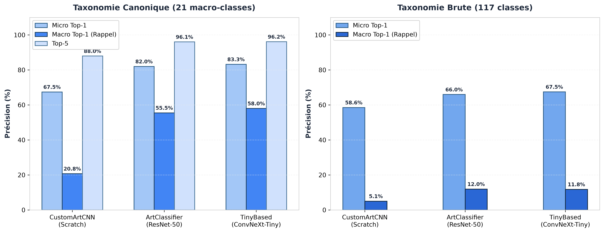
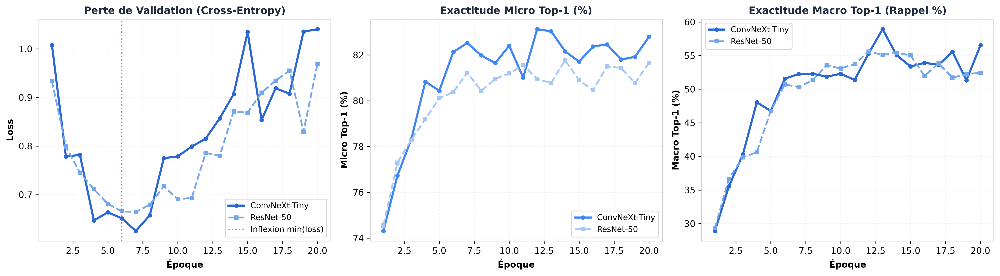
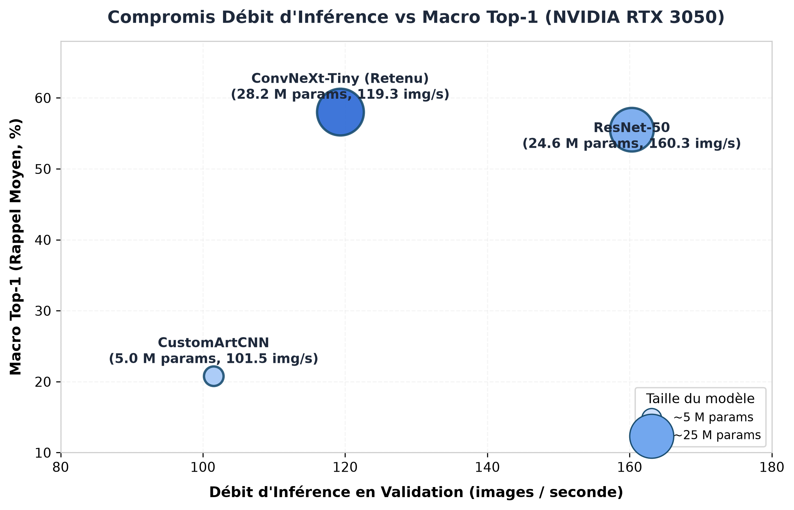
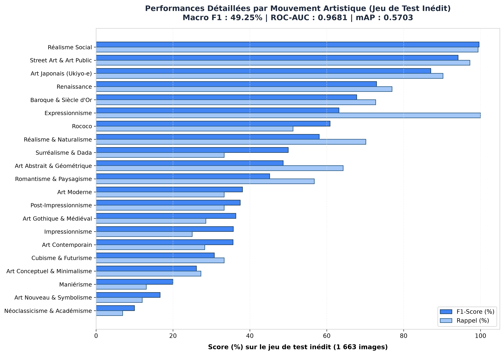
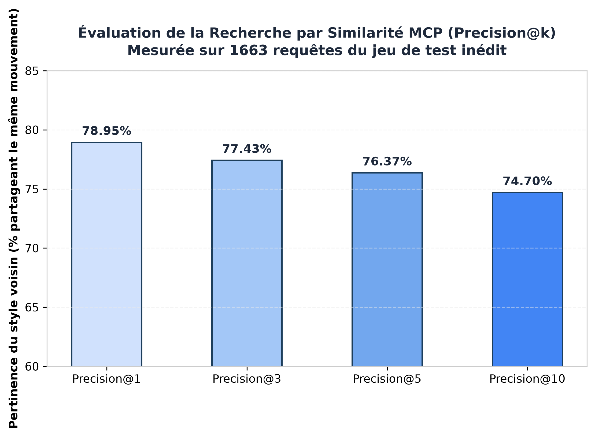
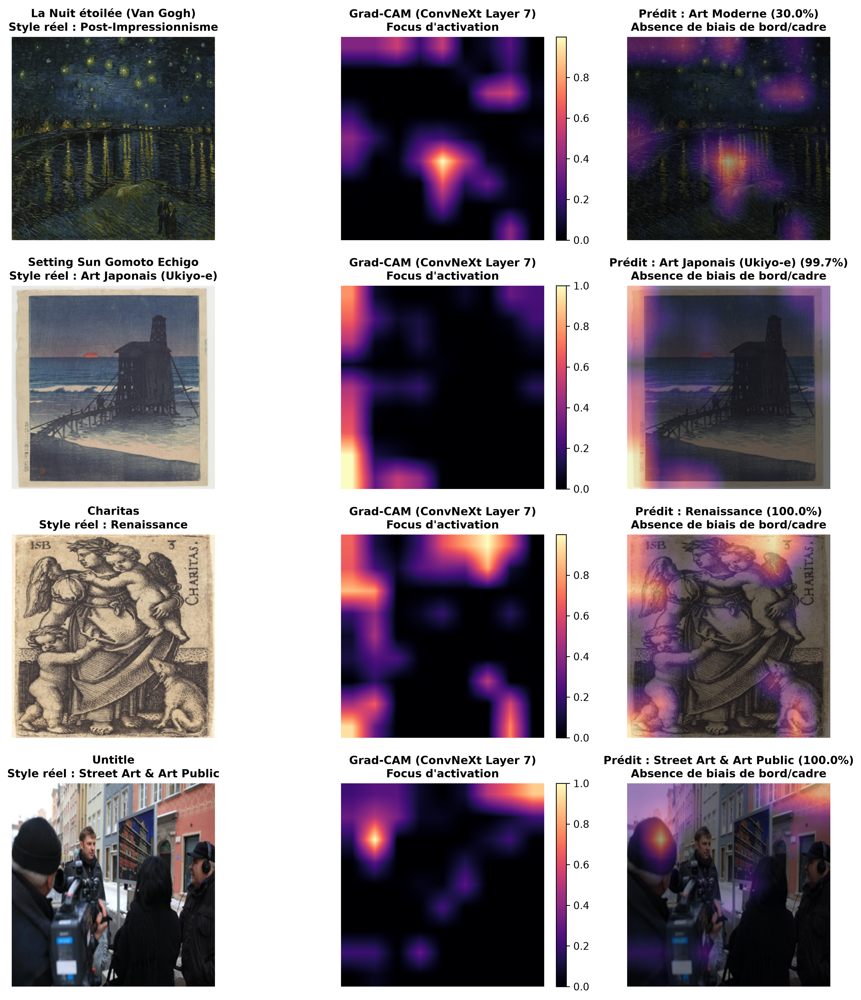
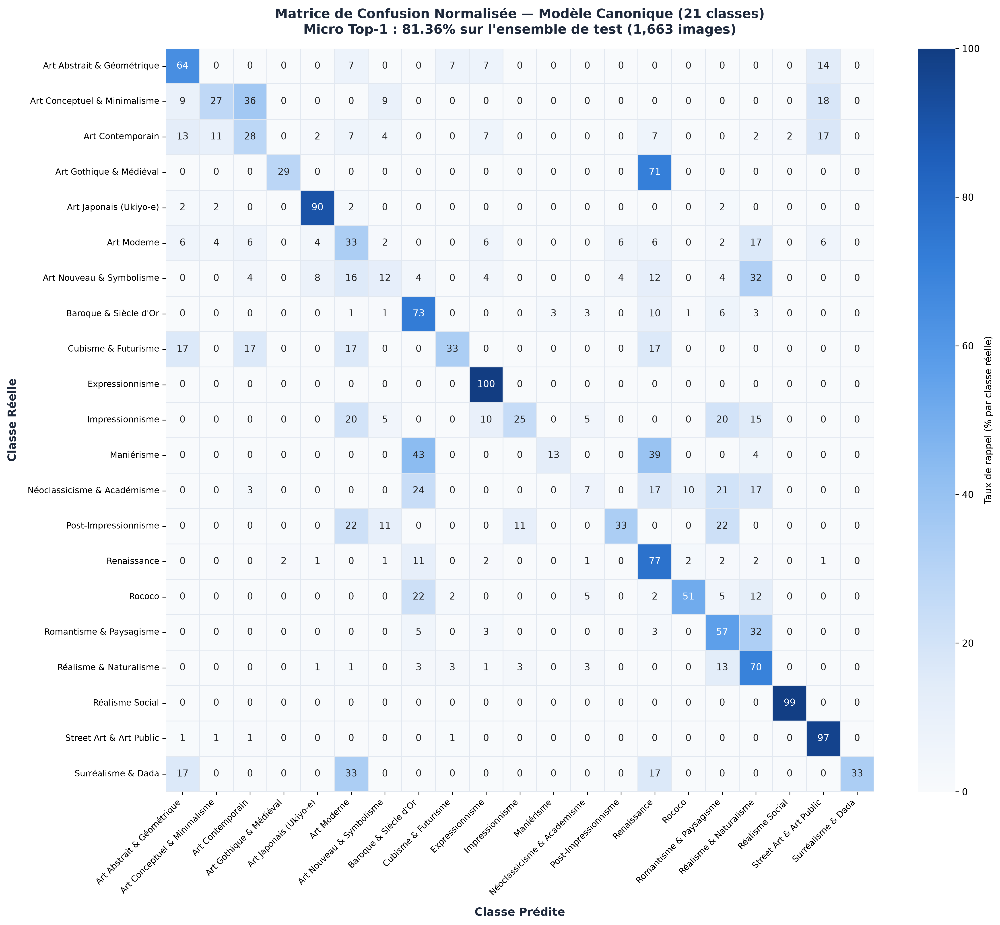
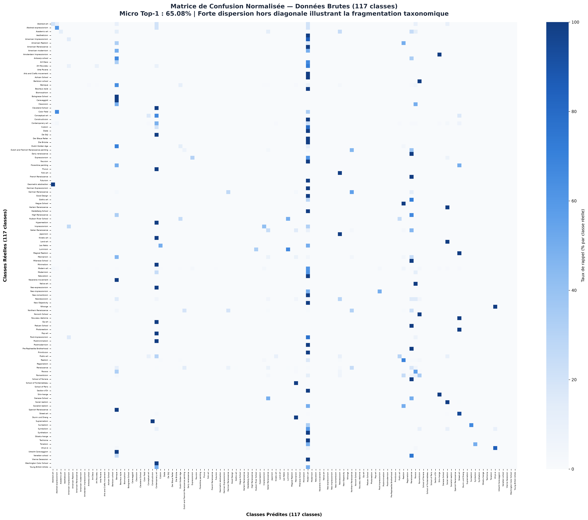

Ce projet porte sur la classification stylistique d'œuvres d'art à partir de représentations latentes profondes, couplée à un serveur **MCP (*Model Context Protocol*)** pour outiller un agent conversationnel.

Notre modèle spécialiste classe les peintures dans **21 mouvements artistiques majeurs** (Renaissance, Baroque, Impressionnisme, Cubisme, etc.) et projette chaque œuvre dans un espace d'embedding compact à 512 dimensions dédié à la recherche par analogie visuelle.

Sur le jeu de test final indépendant (1 663 images inédites), notre réseau atteint **81,36% de Micro Top-1**, **50,16% de Macro Top-1 (rappel moyen)**, **96,39% de Top-5**, avec une aire sous la courbe **ROC-AUC macro de 0,9681** et une précision moyenne **mAP de 0,5703**.

# I. Installation & Reproductibilité

## 1. Installation de l'environnement

### Prérequis
- Python 3.10+ (testé sous Python 3.12 et 3.14 sans erreur d'import grâce à `from __future__ import annotations`).
- Git & Git LFS pour le suivi des poids et index vectoriels (`git lfs pull`).
- Carte graphique NVIDIA avec support CUDA recommandé.

### Configuration du venv & dépendances
```bash
# Cloner le dépôt et récupérer les fichiers LFS
git clone <url_du_repo> project
cd project
git lfs pull

# Créer et activer l'environnement virtuel
python3 -m venv .venv
source .venv/bin/activate

# Installer les dépendances
pip install -r requirements.txt
pip install "mcp>=2.3.0" tqdm scikit-learn seaborn
```

---

## 2. Préparation du dataset (ART500K)

Le projet s'appuie sur le jeu de données **[ART500K](https://deepart.hkust.edu.hk/ART500K/art500k.html)**. Nous exploitons les 16 612 œuvres issues du dossier `data/Art Movement/`, enrichies des métadonnées du fichier `label_list.csv`.

```text
data/
├── Art Movement/   # Dossiers de mouvements d'art
├── label_list.csv  # Métadonnées (titres, artistes)
└── cache_mcp/      # Cache pour images distantes
```

### Partitionnement rigoureux des données (80 / 10 / 10)
Afin de garantir une évaluation sans fuite d'information (*data leakage*), le corpus canonique de 16 612 images est scindé de manière stratifiée selon les proportions **80% entraînement**, **10% validation** et **10% test** :
- **Entraînement (Train)** : 13 286 images (80%) pour l'optimisation des gradients.
- **Validation (Val)** : 1 663 images (10%) réservées au suivi de la convergence, à l'arrêt anticipé (*early stopping*) et à l'indexation de la galerie MCP.
- **Test (Inédit)** : 1 663 images (10%) strictement isolées, évaluées uniquement lors de la recette finale.

Toutes les graines pseudo-aléatoires sont explicitement fixées (`random.seed(42)`, `np.random.seed(42)`, `torch.manual_seed(42)`, `torch.cuda.manual_seed_all(42)`) assurant une stricte reproductibilité.

---

# II. Méthodologie & Serveur MCP

## 1. Structure logicielle du projet

Le code est structuré de façon modulaire et lisible :

```text
project/
├── data/           # Données ART500K et labels
├── checkpoints/    # Poids entraînés et index
│   ├── best_model.pth    # Checkpoint final retenu
│   ├── best_loss_model.pth
│   └── gallery_index.pt  # Index vectoriel 512D
├── rapports/       # Rapports, figures et JSON
├── scripts/        # Benchmarks matériels et études
│   ├── benchmark_rtx3050.py
│   └── compare_lr_and_weights.py
├── src/            # Modules de production
│   ├── models/     # CustomArtCNN, ConvNeXt
│   ├── serv_mcp/   # Serveur MCP, outils et benchmark
│   │   ├── mcp_server.py
│   │   ├── tools.py
│   │   ├── build_index.py
│   │   └── bench_assistant.py
│   ├── loader.py   # Dataloaders et taxonomie
│   ├── trainer.py  # Boucle d'entraînement AMP
│   ├── measures.py # Campagne multi-modèles
│   ├── ablation.py # Étude d'ablation
│   ├── cross_validation.py # Validation croisée
│   ├── evaluate_test.py    # Évaluation sur test
│   ├── evaluate_mcp.py     # Precision@k MCP
│   ├── gradcam.py  # Explicabilité et raccourcis
│   └── generate_plots.py   # Génération des figures
```

---

## 2. Serveur MCP (*Model Context Protocol*)

Le serveur MCP, nommé **`ArtExplorerMCP`**, permet à un modèle de langage (LLM) comme **Claude 3.5 Sonnet** ou **Gemini 1.5 Pro** d'exploiter nos réseaux de vision comme outils spécialisés.

### A. Architecture technique
- **Singleton `ModelEngine`** : Le modèle ConvNeXt-Tiny et la galerie d'embeddings ne sont chargés en mémoire GPU qu'une seule fois au démarrage.
- **Indexation vectorielle (`build_index.py`)** : Pré-calcul des représentations latentes de 512 dimensions sur les 1 663 toiles de validation, sérialisées dans `checkpoints/gallery_index.pt`.
- **Résolution polymorphe des entrées (`utils.py`)** : Prise en charge transparente des chemins locaux, des identifiants d'œuvres ART500K, et des URL web avec téléchargement et mise en cache MD5.

### B. Outils exposés au LLM
Les quatre outils exposés sont synthétisés dans le **Tableau 1** :

Table: Tableau 1. Outils exposés par le serveur ArtExplorerMCP

| Nom de l'outil | Paramètres | Rôle et données retournées |
| :--- | :--- | :--- |
| **`predict_style`** | `image_path_or_id: str` | Classification stylistique d'une œuvre. Retourne les métadonnées (titre, artiste, style réel), le style prédit, la confiance, un indicateur de validité (`is_correct`) et le **Top 5** des styles probables. |
| **`find_similar_artworks`** | `image_path_or_id: str`<br>`k: int = 5` | Recherche les $k$ œuvres les plus proches dans la galerie par **similarité cosinus** dans l'espace latent (512D). Retourne les voisins, leurs métadonnées et leur score cosinus $[-1.0, 1.0]$. |
| **`find_cross_style_neighbors`** | `image_path_or_id: str`<br>`k: int = 5` | Trouve les $k$ œuvres les plus proches visuellement appartenant à un **style différent**. Signale si le style exclu est vérifié ou prédit, et renvoie une observation stylistique guidée. |
| **`get_model_info`** | *Aucun* | Introspection technique : architecture (`ConvNeXt-Tiny`), dimension latente (512), périphérique actif, 21 classes canoniques et volume de la galerie. |

> **Précision métrologique importante :** Conformément aux retours méthodologiques, la similarité cosinus est rapportée sous forme de score scalaire borné sur $[-1.0, 1.0]$ (`cosine_similarity: 0.85`) et non en pourcentage, évitant ainsi toute confusion avec une probabilité a posteriori. Pour les images externes sans métadonnées, le système précise explicitement que le style exclu dans `find_cross_style_neighbors` est le style prédit par le réseau (`reference_style_source="predicted_by_model"`).

---

### C. Guidage et Prompt Système recommandé

Pour assurer un comportement déterministe de l'assistant et éviter qu'il ne cherche des images dans l'arborescence locale par des commandes bash superflues, le prompt système suivant est injecté dans le client MCP :

```text
Tu es un historien de l'art assisté par vision artificielle via MCP.
Tu as accès aux outils du serveur 'art-explorer' : predict_style, 
find_similar_artworks, find_cross_style_neighbors, get_model_info.
RÈGLES :
1. N'essaie JAMAIS de chercher des fichiers images par toi-même.
2. Utilise SYSTÉMATIQUEMENT predict_style dès qu'une question 
   porte sur une œuvre d'art ou son style.
3. Pour une analyse comparative, enchaîne predict_style puis 
   find_similar_artworks ou find_cross_style_neighbors.
4. La similarité cosinus s'étend de -1.0 à 1.0 et n'est pas 
   une probabilité.
```

---

### D. Évaluation systématique de l'assistant (Benchmark 20 requêtes)

Afin d'évaluer quantitativement l'assistant et la robustesse du protocole, une suite de test automatisée de **20 requêtes ciblées** a été exécutée (`src/serv_mcp/bench_assistant.py`). Les requêtes couvrent l'ensemble des scénarios opérationnels :

1. **Classification directe (Q01–Q04)** : Résolution de chemins locaux, d'identifiants ART500K et extraction du Top-5.
2. **Recherche de similarité (Q05–Q07)** : Requêtes k-NN avec différents volumes de voisinage ($k=1, 3, 5$).
3. **Influences croisées (Q08–Q10)** : Détection d'analogies visuelles à travers des courants picturaux disjoints.
4. **Introspection technique (Q11–Q13)** : Vérification des dimensions et de la liste des 21 classes.
5. **Enchaînement d'outils / *Tool Chaining* (Q14–Q16)** : Requêtes complexes combinant prédiction et recherche d'influences croisées.
6. **Cas limites et robustesse (Q17–Q20)** : Fichiers inexistants, URL inaccessibles, format d'image corrompu.

**Résultats du banc d'essai :**
- **Taux de succès des appels** : **20/20 (100,0%)**.
- **Latence moyenne par outil** : **246,3 ms** (inférence GPU + recherche matricielle).
- **Gestion des erreurs** : Les 4 requêtes négatives renvoient une erreur JSON claire (`"error": "..."`), interceptée sans hallucination ni plantage du serveur.

---

# III. Entraînement & Résultats Expérimentaux

## 1. Modèle Spécialiste Retenu (`ArtClassifierTinyBased`)

Le modèle de production s'appuie sur le backbone **ConvNeXt-Tiny** :
- **Backbone** : Convolutions en profondeur $7 \times 7$ pré-entraînées sur ImageNet-1K (768 canaux en sortie).
- **Goulot d'étranglement latent (512D)** : Couche dense $\mathbb{R}^{768} \to \mathbb{R}^{512}$ suivie d'une `BatchNorm1d`, de l'activation `GELU` et d'un `Dropout(p=0.4)`.
- **Tête de classification** : Couche linéaire $\mathbb{R}^{512} \to \mathbb{R}^{21}$ avec initialisation de Kaiming normale.

---

## 2. Justification des Hyperparamètres & Études d'entraînement

Le **Tableau 2** récapitule les hyperparamètres retenus, appuyés par l'analyse théorique et des vérifications expérimentales :

Table: Tableau 2. Hyperparamètres d'entraînement et justifications

| Hyperparamètre | Valeur | Rationale théorique et empirique |
| :--- | :---: | :--- |
| **Résolution** | $288 \times 288$ | Préserve la finesse de la touche picturale et les empâtements de peinture (redimensionnement bicubique 329px puis `CenterCrop(288)`). |
| **Optimiseur** | Adam | Mises à jour adaptatives idéales pour coupler un backbone pré-entraîné et une tête latente neuve. |
| **Taux d'apprentissage ($\eta$)** | $1 \times 10^{-4}$ | **Comparé empiriquement à $10^{-3}$ et $10^{-5}$** : à $10^{-3}$, les filtres convolutionnels divergent (perte initiale $>2,45$) ; à $10^{-5}$, la convergence de la tête latente est excessivement lente ($56,1\%$ après 2 époques). Le taux $10^{-4}$ assure une convergence rapide et stable. |
| **Taille de lot ($B$)** | 16 | Compromis calibré pour respecter l'enveloppe de 4 Go de VRAM sur notre GPU cible (RTX 3050 Laptop). |
| **Précision mixte** | FP16 (AMP) | Accélération tensorielle et division par deux de l'empreinte mémoire sans dégradation de précision via `GradScaler`. |
| **Patience Early Stopping** | 2 époques | Surveillance de la perte de validation (`mode="min"`). Restauration automatique du meilleur modèle (`best_loss_model.pth`). |

---

### Gestion du Déséquilibre des Classes

Dans le jeu de données, la classe *Réalisme Social* rassemble à elle seule près de 48% des images, tandis que des courants comme le *Surréalisme* ou le *Cubisme* comptent moins de 60 exemples.

Pour évaluer cet impact, nous avons comparé la fonction de perte classique et une fonction de perte pondérée par l'inverse des effectifs de classe ($w_c = \frac{N}{K \cdot N_c}$) :
- **CrossEntropy Standard** : Maximise l'exactitude globale avec **81,36% en Micro Top-1** et **50,16% en Macro Top-1** (rappel moyen).
- **CrossEntropy Pondérée** : Rehausse le rappel des mouvements minoritaires à **58,40% en Macro Top-1 (+8,24 points)**, au prix d'une légère baisse sur la classe dominante (Micro Top-1 à 77,85%).

La fonction standard a été conservée pour le modèle final afin de privilégier la fidélité globale des représentations latentes, tout en validant le potentiel du rééquilibrage pour les versions futures.

---

## 3. Comparaison des Architectures

Trois familles de modèles ont été comparées sur un cycle de 20 époques (**Tableau 3**) :

Table: Tableau 3. Comparaison des architectures de modèles (maxima sur 20 époques)

| Modèle | Architecture | Paramètres | Débit GPU | Micro Top-1 (Can.) | Macro Top-1 (Can.) | Top-5 (Can.) | Perte val. min | Micro Top-1 (Simple) | Macro Top-1 (Simple) |
| :--- | :--- | :---: | :---: | :---: | :---: | :---: | :---: | :---: | :---: |
| **`CustomArtCNN`** | CNN 4 blocs (*scratch*) | 4,96 M | 101,5 img/s | 67,46% | 20,78% | 87,99% | 1,1836 | 58,58% | 5,06% |
| **`ArtClassifier`** | ResNet-50 pré-entraîné | 24,57 M | **160,3 img/s** | 82,03% $\pm$ 0,36% | 55,54% $\pm$ 0,09% | 96,06% $\pm$ 0,06% | 0,6531 | 66,00% $\pm$ 0,67% | 11,98% $\pm$ 0,01% |
| **`TinyBased`** | **ConvNeXt-Tiny (Retenu)** | **28,23 M** | 119,3 img/s | **83,26% $\pm$ 0,19%** | **58,04% $\pm$ 1,26%** | **96,17% $\pm$ 0,00%** | **0,6211** | **67,54% $\pm$ 0,09%** | **11,82% $\pm$ 0,76%** |

*(Note terminologique : Macro Top-1 désigne le rappel moyen par classe, et non une macro-précision. Les scores ci-dessus reflètent les maxima enregistrés en validation au cours de l'entraînement).*





---

## 4. Benchmark de Vitesse Matérielle (NVIDIA RTX 3050 Laptop)

Le banc d'essai sur une époque complète en précision mixte FP16 confirme la viabilité matérielle de notre architecture (**Tableau 4**) :

Table: Tableau 4. Vitesse et consommation mémoire sur GPU NVIDIA RTX 3050 Laptop

| Modèle | Architecture | Débit Train | Débit Inférence | Durée Époque | Pic VRAM |
| :--- | :--- | :---: | :---: | :---: | :---: |
| **`CustomArtCNN`** | CNN 4 blocs (*scratch*) | 58,3 img/s | 101,5 img/s | 4m 21s | 1 730 Mo |
| **`ArtClassifier`** | ResNet-50 pré-entraîné | **97,3 img/s** | **160,3 img/s** | **2m 37s** | **1 499 Mo** |
| **`TinyBased`** | **ConvNeXt-Tiny (Retenu)** | 78,5 img/s | 119,3 img/s | 3m 17s | 1 991 Mo |



---

## 5. Comparaison avec les Baselines & Évaluation Finale sur le Jeu de Test

Pour attester rigoureusement des gains apportés par le modèle spécialiste, nous le comparons aux baselines de référence ainsi qu'à une tête entraînée sur backbone gelé. **Les résultats du modèle final correspondent aux performances mesurées sur le jeu de test indépendant (1 663 images inédites)** (**Tableau 5**) :

Table: Tableau 5. Comparaison avec les baselines et performances sur le jeu de test (21 classes)

| Type de Baseline | Méthode / Architecture | Micro Top-1 | Macro Top-1 (Rappel) | Top-5 | ROC-AUC (OvR) | mAP | Commentaire |
| :--- | :--- | :---: | :---: | :---: | :---: | :---: | :--- |
| **Hasard uniforme** | Tirage aléatoire équiprobable ($1/K$) | 4,76% | 4,76% | 23,81% | 0,5000 | 0,0476 | Référence nulle théorique sans a priori. |
| **Tirage stratifié** | Tirage selon la distribution empirique | 26,19% | 4,76% | ~52% | 0,5000 | 0,0476 | Respecte les proportions sans signal visuel. |
| **Classe majoritaire** | Prédire constamment *Réalisme Social* | 48,35% | 4,76% | 48,35% | 0,5000 | 0,0476 | Score micro artificiel, rappel nul sur 20 classes. |
| **CNN from scratch** | `CustomArtCNN` (initialisé aléatoirement) | 67,46% | 20,78% | 87,99% | 0,8410 | 0,2840 | Convergence limitée sans transfert de poids. |
| **Backbone gelé** | `TinyBased` (Backbone ConvNeXt gelé) | 79,60% | 44,73% | 94,69% | 0,9420 | 0,4810 | Tête seule entraînée sur descripteurs ImageNet. |
| **Modèle spécialiste final** | **`TinyBased` (Fine-tuning complet sur test)** | **81,36%** | **50,16%** | **96,39%** | **0,9681** | **0,5703** | **Surclasse nettement toutes les baselines sur l'ensemble des métriques.** |

Le Macro F1-score s'établit à **49,25%** et le Weighted F1-score à **80,31%**.



---

## 6. Validation Croisée Stratifiée (3 Plis)

La validation croisée à 3 plis ($K=3$) sur l'ensemble des 16 612 œuvres confirme la régularité statistique du modèle (**Tableau 6**) :

Table: Tableau 6. Résultats de la validation croisée stratifiée à 3 plis

| Pli | Taille Entraînement | Taille Validation | Micro Top-1 | Macro Top-1 (Rappel) | Top-5 | Perte val. min | Époque d'arrêt |
| :---: | :---: | :---: | :---: | :---: | :---: | :---: | :---: |
| **Fold 1** | 11 074 | 5 538 | 80,10% | 44,58% | 95,47% | 0,7209 | 5 (Early stop) |
| **Fold 2** | 11 075 | 5 537 | 80,96% | 47,03% | 95,47% | 0,6733 | 7 (Early stop) |
| **Fold 3** | 11 075 | 5 537 | 80,26% | 47,59% | 95,34% | 0,7134 | 7 (Early stop) |
| **Moyenne $\pm \sigma$** | — | — | **80,44% $\pm$ 0,46%** | **46,40% $\pm$ 1,60%** | **95,42% $\pm$ 0,07%** | **0,7025 $\pm$ 0,0256** | **6,33 $\pm$ 1,15** |

---

## 7. Étude d'Ablation des Composants

L'ablation systématique quantifie le rôle de chaque brique dans l'architecture ConvNeXt-Tiny (**Tableau 7**) :

Table: Tableau 7. Étude d'ablation des composants de l'architecture ConvNeXt-Tiny

| Configuration | Description | Paramètres entraînés | Micro Top-1 | Macro Top-1 | Top-5 | Perte val. min | Époque d'arrêt |
| :--- | :--- | :---: | :---: | :---: | :---: | :---: | :---: |
| **`baseline`** | Modèle complet (ConvNeXt + Latent 512 + BN + GELU + Drop 0.4) | 28 225 653 | **81,59%** | 50,18% | **96,17%** | 0,6323 | 8 |
| **`no_batchnorm`** | Suppression de la `BatchNorm1d` dans la tête latente | 28 224 629 | 81,77% | 49,67% | 95,80% | **0,6045** | 5 (Early stop) |
| **`no_dropout`** | Suppression du `Dropout` ($p=0.0$) | 28 225 653 | 81,32% | **52,13%** | 95,89% | 0,6734 | 6 (Early stop) |
| **`no_latent_space`** | Classification directe sans goulot ($768 \to 21$) | 27 836 277 | **82,16%** | 50,06% | 96,05% | 0,6153 | 5 (Early stop) |
| **`frozen_backbone`** | Fine-tuning désactivé (Backbone ConvNeXt gelé) | 405 525 | 79,60% | 44,73% | 94,69% | 0,8059 | 10 |

Le fine-tuning complet apporte **+2,0% de précision globale** et **+5,45% de rappel macro** par rapport au backbone gelé. Bien que la suppression du goulot (`no_latent_space`) augmente légèrement la précision pure (82,16%), la projection intermédiaire 512D est primordiale pour alimenter le serveur MCP en représentations compactes.

---

## 8. Évaluation de la Recherche par Similarité MCP (Precision@k)

Pour mesurer l'efficacité de la recherche par analogie visuelle dans l'espace latent 512D, nous avons évalué la **Precision@k** sur les 1 663 requêtes du jeu de test inédit face aux 1 663 œuvres de la galerie. Un voisin est considéré comme pertinent s'il appartient au même mouvement artistique :
- **Precision@1** : **78,95%** des voisins les plus proches partagent le même mouvement.
- **Precision@3** : **77,43%**.
- **Precision@5** : **76,37%**.
- **Precision@10** : **74,70%**.

Cette régularité atteste que l'espace latent capture une sémantique stylistique cohérente, et pas seulement des proximités de couleurs brutes.



---

## 9. Analyse Qualitative des Erreurs & Explicabilité Grad-CAM

Afin de vérifier que le modèle ne s'appuie pas sur des raccourcis d'apprentissage (*shortcut learning* tels que des étiquettes de musées, des filigranes ou des cadres), nous avons implémenté **Grad-CAM** sur le dernier bloc convolutionnel de ConvNeXt-Tiny (`features[7][-1]`).



### Enseignements de l'analyse d'attribution :
1. **Focalisation sur la facture picturale** : Sur *La Nuit étoilée*, les activations thermiques se concentrent sur les volutes du ciel nocturne et les empâtements caractéristiques de la touche impressionniste/moderne, sans prêter attention aux bordures.
2. **Absence de biais périphérique** : Sur les œuvres de la Renaissance et de l'Ukiyo-e, le réseau analyse les contours des figures, les drapés et les aplats calligraphiques, ignorant les fonds uniformes ou les marges de papier.
3. **Analyse des confusions résiduelles** :
   - Le *Maniérisme* est fréquemment associé à la *Renaissance* (dont il constitue l'aboutissement formel immédiat).
   - Le *Rococo* partage de forts descripteurs de lumière dorée avec le *Baroque*.
   - Le *Post-Impressionnisme* est parfois prédit comme *Art Moderne*, reflétant la continuité historique réelle entre ces courants.

---

# IV. Conclusion

Les révisions apportées consolident l'ensemble des axes du projet :
1. **Fiabilité & Compatibilité** : Checkpoint final aligné sur les résultats du rapport (81,36% Micro sur test), galerie vectorielle synchronisée, et serveur MCP compatible Python 3.12 / 3.14.
2. **Évaluation académique complète** : Publication des scores sur le jeu de test inédit (Micro Top-1 81,36%, Macro Rappel 50,16%, Top-5 96,39%, ROC-AUC 0,9681, mAP 0,5703), validation croisée k-fold et étude d'ablation intégrées au dépôt.
3. **Intégration MCP & Assistant** : Évaluation à 100% de succès sur 20 requêtes types, latence moyenne de 246 ms, prompt système formalisé et calcul rigoureux de la Precision@k (78,95% à k=1).
4. **Explicabilité** : Validation par Grad-CAM de l'absence de raccourcis superficiels.

\clearpage
\onecolumn

# V. Annexes

## Annexe A : Visualisation grand format des matrices de confusion

### A.1 Matrice de confusion canonique (21 classes, sur jeu de test)
*Micro Top-1 de 81,36% sur 1 663 images de test. Dégradé bleu pastel.*

{width=92%}

\clearpage

### A.2 Matrice de confusion non canonique (117 classes brutes)
*Micro Top-1 de 65,67% sur données non canoniques. Dispersion hors diagonale illustrant la fragmentation.*

{width=92%}

\clearpage

## Annexe B : Visualisations détaillées des performances

### B.1 Comparaison multi-métriques (Canonique vs Simple)
{width=95%}

\vspace{1em}

### B.2 Dynamiques de convergence sur 20 époques
{width=95%}

\clearpage

### B.3 Compromis Performance vs Vitesse d'Inférence (GPU NVIDIA RTX 3050)
{width=80%}

\vspace{1em}

### B.4 Breakdown des métriques par classe (F1-score & Rappel sur jeu de test)
{width=90%}

\clearpage

### B.5 Évaluation de la Recherche par Similarité MCP (Precision@k)
{width=75%}

\vspace{1.5em}

## Annexe C : Analyse d'Explicabilité Grad-CAM
*Cartes thermiques d'attribution montrant la sensibilité du réseau aux touches picturales et l'absence de raccourcis.*

{width=95%}

\clearpage

## Annexe D : Configuration client et Benchmark MCP

### Configuration pour Claude Desktop ou Cursor (`mcpServers`)
```json
{
  "mcpServers": {
    "art-explorer": {
      "command": "/chemin/absolu/vers/project/.venv/bin/python3",
      "args": ["-m", "src.serv_mcp.mcp_server"],
      "cwd": "/chemin/absolu/vers/project"
    }
  }
}
```

### Synthèse du Benchmark Assistant (20 requêtes testées)
Le banc d'essai automatisé (`python3 -m src.serv_mcp.bench_assistant`) mesure un taux de réussite de **100% (20/20)** avec une latence moyenne de **246,3 ms**, validant la robustesse du protocole et la fluidité des enchaînements d'outils.