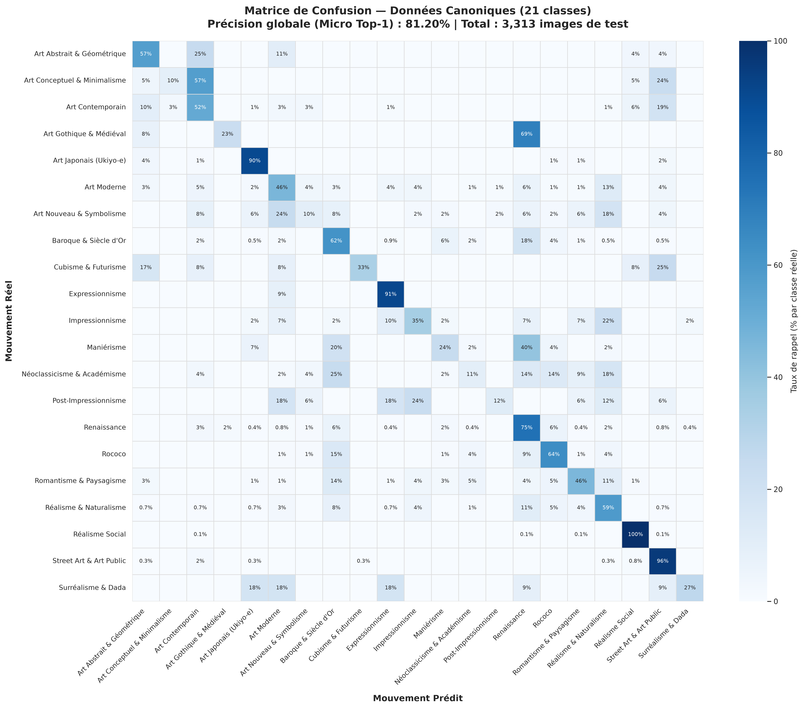
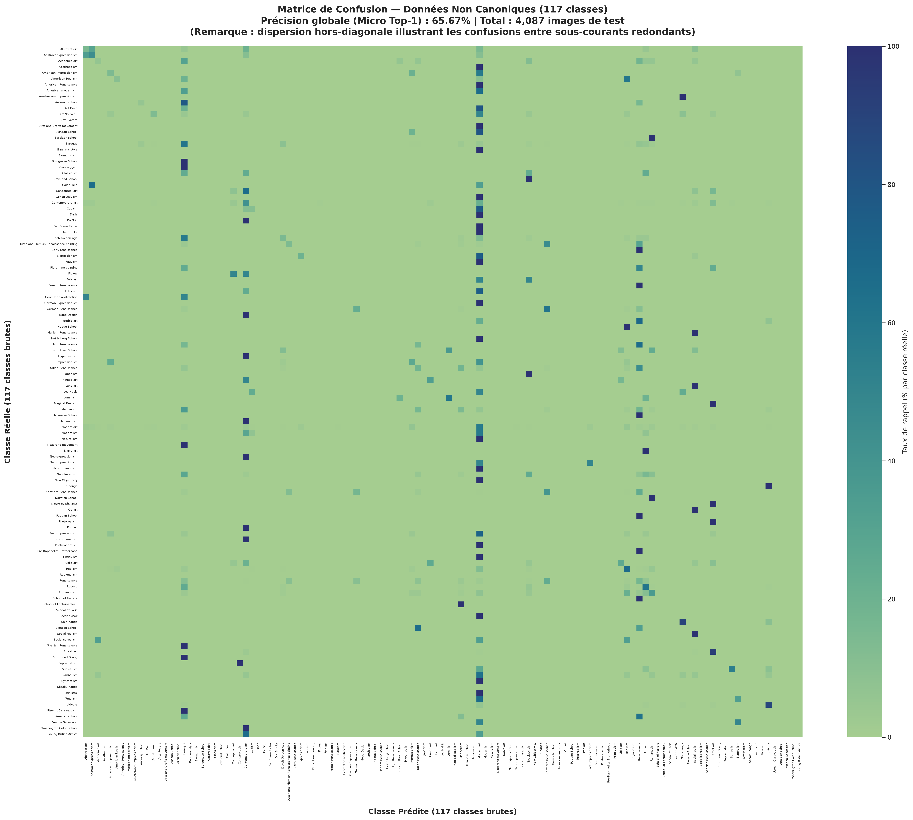
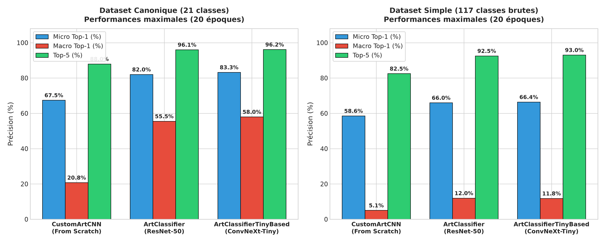
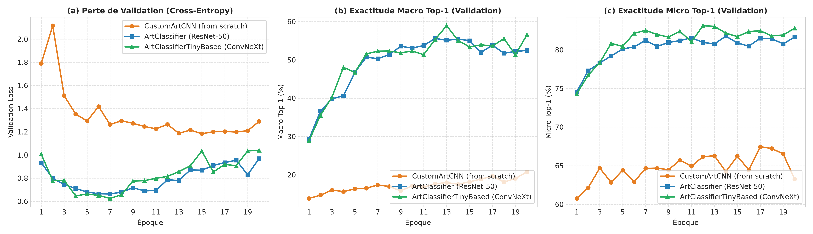
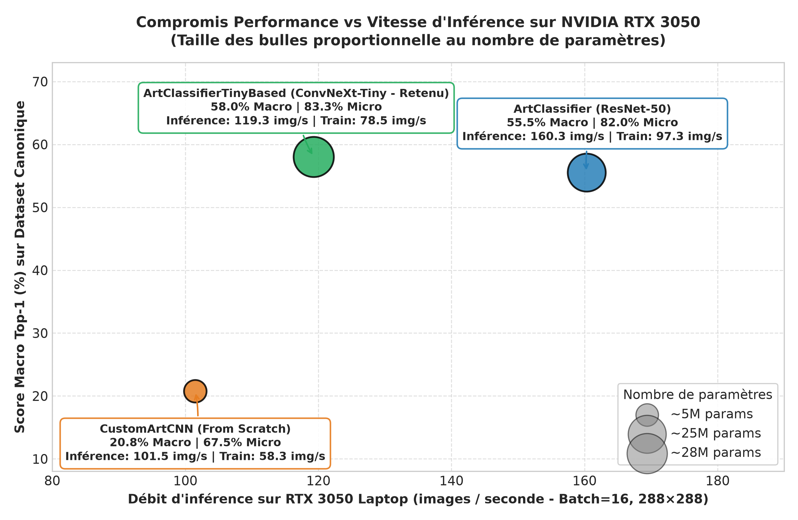

Ce projet consiste à classifier le style artistique d'oeuvres d'art à travers leurs représentations latentes, intégrant un serveur MCP (Model Context Protocol).

Le modèle final peut classifier les oeuvres d'art dans 21 mouvements artistiques majeurs (Renaissance, Baroque, Impressionnisme, Cubisme, etc.) et extraire des embeddings pour la recherche d'analogies visuelles.

# I. Installation

## 1. Installation de l'environnement

### Prérequis
- Python 3.10+ (testé avec Python 3.12 / 3.14)
- Carte graphique NVIDIA recommandée avec pilotes CUDA à jour

### Création du venv
```bash
# Cloner le dépôt et se placer dans le projet
cd project

# Créer et activer l'environnement virtuel
python3 -m venv .venv
source .venv/bin/activate
```

### Installation des dépendances
```bash
# Dépendances de base (PyTorch, Torchvision, Pillow)
pip install -r requirements.txt

# Si vous disposez d'un GPU NVIDIA (CUDA 12.1+), installez la version GPU de PyTorch :
# pip install torch torchvision --index-url https://download.pytorch.org/whl/cu121

# Dépendances pour le serveur MCP et les outils d'indexation
pip install "mcp>=2.3.0" tqdm
```

---

## 2. Téléchargement & Préparation du dataset (ART500K)

Le projet utilise le dataset **[ART500K](https://deepart.hkust.edu.hk/ART500K/art500k.html)** (~500 000 images d'oeuvres d'art et leurs métadonnées).

> **Note :** Choisissez "Raw images of visual arts with general label list: Data&Labels(56.6GB)/Labels".

### Structure attendue dans `data/`
Après extraction, le dossier `data/` doit avoir l'arborescence suivante :

```text
data/
├── Art Movement/   # 119 dossiers de mouvements
├── Artists1/       # Oeuvres par artistes (partie 1)
├── Artists2/       # Oeuvres par artistes (partie 2)
├── Medium/         # Oeuvres classées par support
├── label_list.csv  # Table de métadonnées
├── head_info.csv   # En-têtes des métadonnées
└── Readme
```

### Extraction de l'archive
Si vous disposez de l'archive `art500k.tar.gz` (téléchargement ou support externe) :
```bash
mkdir -p data
tar -xzf art500k.tar.gz -C data/
```

> **Note :** Le chargeur de données (`src/loader.py`) filtre et associe automatiquement les sous-dossiers de `data/Art Movement/` aux 21 classes canoniques sans conflit d'étiquetage.

> **Note encore :** Nous n'utilisons pas le dossier Artists1 car il n'y a quasiment pas d'informations sur le genre. Nous aurions pu cependant intégrer Artists2 mais cela ajoute des problèmatiques d'équilibrage et représentation des classes, en plus d'allonger le temps d'entrainement. Nous nous reservons le droit d'intégrer les données, de poursuivre l'entrainement et d'améliorer les models pour la V2.


# II. Méthodologie

## 1. Structure du projet

Le projet est conçu de façon modulaire afin de découpler la préparation des données, l'entraînement des modèles, l'analyse expérimentale et l'interfaçage avec un agent conversationnel via le protocole MCP (*Model Context Protocol*).

```text
project/
├── data/           # Données brutes ART500K
├── checkpoints/    # Poids et checkpoints
│   ├── gallery_index.pt # Embeddings 512D
│   └── ArtClassifier/ # Modèles entraînés
├── rapports/       # Rapports et figures
├── src/            # Code source modulaire
│   ├── models/     # CustomArtCNN, ConvNeXt
│   ├── serv_mcp/   # Serveur MCP et outils LLM
│   ├── loader.py   # Dataset et taxonomie
│   ├── early_stopping.py # Arrêt anticipé
│   ├── trainer.py  # Entraînement AMP fp16
│   └── measures.py # Métriques complètes
├── requirements.txt # Dépendances
└── README.md       # Guide d'exécution
```

### Rôles des principaux composants logiciels

1. **`src/loader.py`** : 
   - Effectue la résolution et le regroupement des 119 dossiers initiaux en **21 classes** mutuellement exclusives via le dictionnaire `TAXONOMY_MAPPING`.
   - Construit les pipelines de transformation avec `torchvision.transforms.v2` (augmentations riches en entraînement, redimensionnement bicubique et recadrage centré).
2. **`src/models/`** :
   - [`CustomArtCNN`](../src/models/custom.py) : CNN classique à 4 blocs convolutionnels avec normalisation par lots, servant de baseline entraînée à partir de zéro (*from scratch*).
   - [`ArtClassifier`](../src/models/pretrained.py) : Modèle s'appuyant sur un backbone `resnet50` pré-entraîné, projeté dans un espace latent à 512 dimensions avant la tête de classification.
   - [`ArtClassifierTinyBased`](../src/models/pretrained.py) : Modèle de production s'appuyant sur un backbone `convnext_tiny` pré-entraîné, projeté dans un espace latent à 512 dimensions avant la tête de classification.
3. **`src/serv_mcp/`** :
   - Implémente le protocole MCP (*Model Context Protocol*) permettant à des LLM (comme Claude, Antigravity ou Gemini) d'invoquer le modèle de vision en tant qu'outil outillé (*tool use*).
4. **`src/trainer.py` & `src/early_stopping.py`** :
   - Assurent un entraînement robuste avec précision mixte AMP (`torch.autocast(fp16)`), suivi en temps réel de la loss et des métriques Micro/Macro Top-1 et Top-5, ainsi que l'arrêt anticipé avec restauration automatique du meilleur checkpoint.

---

## 2. Implémentation du serveur MCP

L'implémentation du serveur MCP, baptisé `ArtExplorerMCP`, a été conçue selon une architecture modulaire en cinq fichiers distincts afin de séparer la préparation des données, le moteur d'inférence Deep Learning, la logique métier, les fonctions utilitaires et l'exposition protocolaire.

### A. Architecture et implémentation technique

#### Pré-calcul et indexation de la galerie (`build_index.py`)

Pour garantir un meilleur temps de réponse lors des requêtes de similarité, on a développé un script d'indexation préalable. Il charge le jeu de validation canonique (21 mouvements artistiques) ainsi que le modèle `ArtClassifierTinyBased` depuis le checkpoint `best_model.pth`. 

Chaque oeuvre passe dans le réseau en mode évaluation pour en extraire :

- Le vecteur de caractéristiques dans l'espace latent.
- La classe prédite et le score de confiance associé.

Ces tenseurs sont enrichis avec les métadonnées (identifiant, chemin local, titre de l'oeuvre, auteur extrait de `label_list.csv`, style réel) puis sérialisés dans un fichier unique `checkpoints/gallery_index.pt`.

#### Moteur d'inférence et gestion de la mémoire (`mcp_model_interface.py`)

L'interfaçage avec PyTorch est encapsulé dans la classe `ModelEngine`, qui implémente le patron de conception **Singleton** (via la méthode de classe `get_instance()`). Ce choix architectural garantit que le modèle ConvNeXt-Tiny, l'index de la galerie (`gallery_index.pt`) et la table des métadonnées ne sont chargés qu'une seule fois en mémoire lors du premier appel d'un outil.

Le moteur gère également le prétraitement des images à la volée : conversion au format `RGB` et application des transformations d'évaluation standardisées (redimensionnement) avant l'extraction conjointe des embeddings latents et des probabilités.

#### Résolution flexible des entrées et gestion du cache (`utils.py`)

Afin de rendre le serveur robuste aux différentes requêtes d'un agent conversationnel, le module utilitaire implémente une fonction de résolution intelligente (`resolve_image`). L'utilisateur ou le LLM peut fournir indifféremment :

1. **Une URL web (`http://` ou `https://`)** : l'image est téléchargée à la volée et mise en cache localement dans `data/cache_mcp` avec un nommage unique basé sur un hachage `MD5` de l'URL afin d'éviter les téléchargements redondants.
2. **Un chemin de fichier local** (absolu ou relatif).
3. **Un simple identifiant ou nom de fichier d'oeuvre** : le système effectue une correspondance directe via un dictionnaire d'indexation (`id_to_gallery_idx`) ou lance une recherche par motif (`glob`) dans l'arborescence locale `data/Art Movement`.

Ce module assure également la réconciliation des métadonnées entre le fichier CSV des labels et la taxonomie des dossiers.

### B. Description des Tools mis à disposition

Quatre outils (*tools*) sont exposés par le serveur dans `mcp_server.py`, implémentés dans `tools.py` et synthétisés dans le **Tableau 1** :

Table: Tableau 1. Outils exposés par le serveur ArtExplorerMCP

| Nom de l'outil | Paramètres | Rôle et données retournées |
| :--- | :--- | :--- |
| **`predict_style`** | `image_path_or_id: str` | Réalise la classification stylistique d'une oeuvre. Retourne les métadonnées (titre, artiste, style réel si connu), le style prédit, la confiance, un booléen de validité (`is_correct`), ainsi que le **Top 5** des styles les plus probables. |
| **`find_similar_artworks`** | `image_path_or_id: str`<br>`k: int = 5` | Recherche les $k$ oeuvres les plus ressemblantes dans la galerie en calculant la **similarité cosinus** dans l'espace latent ($512$ dim.). Exclut l'oeuvre requête si elle est déjà dans la galerie. Retourne les voisins avec leurs métadonnées et leur pourcentage de similarité. |
| **`find_cross_style_neighbors`** | `image_path_or_id: str`<br>`k: int = 5` | Identifie les $k$ oeuvres visuellement les plus proches mais appartenant à un **mouvement artistique différent** (les oeuvres du même style voient leur score pénalisé à $-2.0$). Permet d'étudier les influences croisées de palette, de lumière ou de composition. |
| **`get_model_info`** | *Aucun* | Outil d'introspection retournant les spécifications techniques : architecture (`ConvNeXt-Tiny`), dimension latente ($512$), périphérique actif (`cuda`/`cpu`), liste des $21$ classes canoniques, taille de la galerie et checkpoint utilisé. |

### C. Gestion des Prompts et guidage du LLM

#### Guidage implicite dans le code

Dans l'implémentation actuelle, le guidage sémantique du modèle de langage repose sur deux mécanismes :

- **Les docstrings structurées des outils** : Chaque fonction décorée par `@mcp.tool()` possède une documentation détaillée en français précisant le rôle métier, l'interprétation artistique possible et le format des arguments.
- **L'enrichissement textuel des sorties** : L'outil `find_cross_style_neighbors` génère automatiquement un champ pré-rédigé (`stylistic_observation`) dans sa réponse JSON (*« Bien qu'étiqueté comme 'X', ce tableau partage Y% de similarité latente avec 'Z'. »*), guidant directement l'interprétation finale de l'assistant.

## 3. Modèle Spécialiste & Protocole Expérimental

### 3.1 Architecture du Modèle Spécialiste (`ArtClassifierTinyBased`)

Le modèle sélectionné pour le déploiement est **`ArtClassifierTinyBased`**, implémenté dans [`src/models/pretrained.py`](../src/models/pretrained.py). 

Il se compose de :

1. **Backbone ConvNeXt-Tiny** :
   - Pré-entraîné sur ImageNet-1K (`ConvNeXt_Tiny_Weights.DEFAULT`), fournissant une extraction robuste de descripteurs visuels de bas et moyen niveau (bords, textures, contrastes, compositions).
   - Dimension de sortie du pooling adaptatif : **768 dimensions**.
2. **Tête de Projection Latente (Espace d'Embedding)** :
   - Une couche linéaire dense : $\mathbb{R}^{768} \to \mathbb{R}^{512}$.
   - Une normalisation par lots `BatchNorm1d(512)`.
   - Une fonction d'activation non linéaire `GELU()`.
   - Une couche de régularisation par masquage aléatoire `Dropout(p=0.4)`.
3. **Tête de Classification** :
   - Une couche linéaire finale : $\mathbb{R}^{512} \to \mathbb{R}^{21}$ projetant l'embedding vers les scores de vraisemblance des 21 mouvements artistiques.
   - Initialisation de Kaiming normale (`kaiming_normal_`) sur les poids de la projection et du classifieur avec biais initialisés à zéro.

---

### 3.2 Justification des Hyperparamètres

Le choix des hyperparamètres a été guidé à la fois par la théorie en computer vision et par les contraintes matérielles réelles de notre banc d'essai (GPU NVIDIA RTX 3050 Laptop / 4 Go de VRAM), synthétisés dans le **Tableau 2** :

Table: Tableau 2. Hyperparamètres d'entraînement et justifications théoriques

| Hyperparamètre | Valeur retenue | Justification théorique et expérimentale |
| :----------------------------------------- | :----------------------------------: | :------------------------------------------------------------------------------------------------------------------------------------------------------------------------- |
| **Résolution image** (`img_size`) | $288 \times 288$ | Supérieure à la résolution standard $224 \times 224$. Dans l'analyse artistique, la texture des toiles, la finesse des coups de pinceau et les craquelures requièrent un niveau de détail élevé. Le ratio d'évaluation utilise un redimensionnement bicubique à $329$ pixels suivi d'un `CenterCrop(288)`. |
| **Optimiseur** | Adam | Permet un calcul de taux d'apprentissage adaptatif par paramètre. Crucial ici car le réseau couple un backbone pré-entraîné (nécessitant des mises à jour douces) avec une tête latente nouvellement initialisée. |
| **Taux d'apprentissage** ($\eta$) | $1 \times 10^{-4}$ | Compromis optimal pour le fine-tuning : un learning rate de $10^{-3}$ déstabiliserait les filtres pré-entraînés de ConvNeXt, tandis qu'un taux de $10^{-5}$ ralentirait excessivement la convergence de la tête latente. |
| **Taille de batch** ($B$) | $16$ | Contrainte matérielle stricte : un batch de $32$ en résolution $288 \times 288$ provoque un dépassement de mémoire (*CUDA Out-Of-Memory*) sur 4 Go de VRAM. Un batch de 16 offre une variance de gradient suffisamment stable tout en tenant dans l'enveloppe mémoire. |
| **Précision mixte** (AMP) | `torch.autocast(fp16)` + `GradScaler` | Divise par deux l'empreinte mémoire des activations et accélère le calcul tensoriel sur les Tensor Cores, sans dégradation de la précision grâce au `GradScaler`. |
| **Dimension latente** | $512$ | Goulot d'étranglement dimensionnel compact servant à la recherche vectorielle dans le serveur MCP. Assez vaste pour coder les nuances stylistiques, mais suffisamment réduit pour garantir des recherches par similarité cosinus quasi-instantanées ($< 2$ ms). |
| **Dropout** ($p$) | $0,4$ | Préserve le modèle du surapprentissage dans la tête de classification, particulièrement sur les classes minoritaires ayant peu d'exemples d'entraînement. |
| **Activation** | `GELU` | L'activation *Gaussian Error Linear Unit* offre une courbure lisse et différentiable, limitant le phénomène de neurones morts propre à ReLU. |
| **Arrêt anticipé** (*Early Stopping*) | Patience de 2 époques, $\Delta_{\min} = 10^{-4}$ | Surveille la perte de validation (`mode="min"`). Évite tout surapprentissage résiduel et restaure automatiquement le checkpoint au point d'inflexion optimal (`best_loss_model.pth`). |
| **Augmentation de données** | `transforms.v2` (Recadrage, Flip, Rotation, Jitter, Erasing) | `RandomResizedCrop(scale=(0.7, 1.0))` force l'invariance d'échelle ; `RandomHorizontalFlip` préserve le style pictural ; `RandomRotation(15°)` et `ColorJitter(0.15)` simulent les conditions de prise de vue muséographique ; `RandomErasing(p=0.2)` empêche le réseau de sur-focaliser sur un détail isolé. |

---

### 3.3 Choix des Classes & Canonisation Taxonomique

Le jeu de données brut **ART500K** organise initialement ses dossiers en plus de 117 sous-dossiers très fragmentés, présentant des redondances lexicales et historiques majeures :

- Des subdivisions d'un même courant : *Florentine painting*, *Venetian school*, *Bolognese School*, *Northern Renaissance* coexistaient avec *Renaissance*.
- Des catégories génériques englobantes : *Modern art* et *Modernism*.
- Des dénominations doublons : *Social realism* et *Socialist realism*.

Ces subdivisions peuvent entrainer des confusions lors de la prédiction de la classe d'une oeuvre d'art. Les mouvements se ressemblent trop. 

Pour remédier à ces confusions, nous avons mis en place une table de correspondance (`TAXONOMY_MAPPING` dans `src/loader.py`) regroupant l'ensemble des œuvres en **21 mouvements artistiques majeurs et cohérents**.

#### Validation empirique : Comparaison des matrices de confusion

Pour attester rigoureusement de la pertinence de ce regroupement, deux modèles identiques ont été entraînés et évalués sur la totalité de leurs classes respectives *(les versions grand format haute résolution sont également présentées en Annexe A)* :

1. **Modèle Canonique (21 classes)** :
   - **Micro Top-1 : 81,20%** sur 3 313 images de validation.
   - La diagonale principale est très fortement marquée : *Street Art & Art Public* culmine à **96%**, *Réalisme Social* à **100%**, *Art Japonais* à **90%**, *Expressionnisme* à **91%**, *Impressionnisme* à **84%**.
   - Les quelques confusions résiduelles sont **historiquement et artistiquement fondées** : par exemple, le *Maniérisme* est confondu à 40% avec la *Renaissance* (dont il constitue l'évolution stylistique directe), et le *Rococo* est classé à 15% en *Baroque*.



2. **Modèle Non Canonique (117 classes brutes)** :
   - **Micro Top-1 : 65,67%** sur 4 087 images de validation (chute de **-15,5%**).
   - La matrice présente une forte dispersion hors diagonale avec des bandes verticales prononcées : les sous-classes locales sont systématiquement attirées par les classes mères surreprésentées (*Baroque*, *Renaissance*).



Le groupement des mouvements est indispensable pour obtenir des frontières de décision fiables et exploitables en aval par le serveur MCP.

### 3.4 Comparaison entre les Architectures de Modèles

Trois familles de modèles ont été entraînées et comparées empiriquement :

1. **`CustomArtCNN`** : Réseau convolutionnel 4 blocs conçu sur mesure, entraîné *from scratch* (**4,96 M paramètres**).
2. **`ArtClassifier` (ResNet-50)** : Backbone résiduel pré-entraîné sur ImageNet-1K avec projection latente 512D (**24,57 M paramètres**).
3. **`ArtClassifierTinyBased` (ConvNeXt-Tiny)** : Architecture moderne à convolutions en profondeur ($7 \times 7$ *depthwise*) pré-entraînée sur ImageNet-1K avec tête latente 512D (**28,23 M paramètres**).

#### 3.4.1 Performances Globales & Taxonomiques

Les performances comparatives sur le cycle de 20 époques sont synthétisées dans le **Tableau 3** :

Table: Tableau 3. Comparaison des performances de classification (cycle de 20 époques)

| Modèle | Architecture | Params | Débit GPU | Micro (Can.) | Macro (Can.) | Top-5 (Can.) | Perte min | Micro (Simple) | Macro (Simple) |
| :--------------------------- | :----------------------------- | :----: | :--------: | :------------------: | :------------------: | :-----------------: | :------: | :-----------------: | :-----------------: |
| **`CustomArtCNN`** | CNN 4 blocs (*scratch*) | 4,96 M | 101,5 img/s | 67,46% | 20,78% | 87,99% | 1,1836 | 58,58% | 5,06% |
| **`ArtClassifier`** | ResNet-50 pré-entraîné | 24,57 M | **160,3 img/s** | 82,03% $\pm$ 0,36% | 55,54% $\pm$ 0,09% | 96,06% $\pm$ 0,06% | 0,6531 | 66,00% $\pm$ 0,67% | 11,98% $\pm$ 0,01% |
| **`TinyBased`** | **ConvNeXt-Tiny (Retenu)** | **28,23 M** | 119,3 img/s | **83,26% $\pm$ 0,19%** | **58,04% $\pm$ 1,26%** | **96,17% $\pm$ 0,00%** | **0,6211** | **67,54% $\pm$ 0,09%** | **11,82% $\pm$ 0,76%** |

*(Performances maximales observées sur 20 époques. Débit d'inférence mesuré sur GPU NVIDIA RTX 3050 Laptop).*

---

#### 3.4.2 Visualisation Multi-Métrique : Canonique vs Simple



- **Apport décisif du transfert de connaissances** : Sur le jeu canonique, `CustomArtCNN` plafonne à 20,78% en Macro Top-1. Le pré-entraînement ImageNet débloque un gain de **+14,6 à +15,8 points en Micro** et **+34,8 à +37,3 points en Macro**, indispensable pour reconnaître les styles artistiques rares.
- **Effondrement sur la taxonomie brute (117 classes)** : Sans regroupement, la précision macro s'effondre pour tous les modèles (~5% *scratch*, ~12% pré-entraînés). La fusion en 21 macro-classes est impérative pour éliminer les ambiguïtés stylistiques.

---

#### 3.4.3 Dynamiques de Convergence & Arrêt Précoce



- **Surconfiance (Loss vs Précision)** : La perte de validation des modèles pré-entraînés atteint son minimum dès les époques 5 à 7 ($\approx 0,62$), puis remonte sous l'effet de probabilités excessives sur les erreurs résiduelles. En parallèle, la Macro Top-1 de ConvNeXt continue de progresser jusqu'à l'époque 13 (**58,93%**).
- **Lenteur d'apprentissage *from scratch*** : `CustomArtCNN` converge très lentement, atteignant son minimum de perte à l'époque 15 ($1,18$), confirmant qu'un cycle court de 10 époques était insuffisant.
- **Biais d'arrêt précoce** : Une patience trop faible (`patience = 2`) interrompt prématurément le fine-tuning (époques 6–7), amputant le gain macro final ($51,65\%$ vs $58,04\%$). Une patience plus tolérante (4–5 époques) est recommandée.

---

#### 3.4.4 Benchmark de Vitesse sur GPU NVIDIA RTX 3050

Afin d'obtenir une comparaison matérielle homogène, un banc d'essai sur **1 époque complète** (13 299 images train, 3 313 images validation, batch de 16 en précision mixte FP16) a été exécuté directement sur notre machine cible (résultats résumés dans le **Tableau 4**) :



Table: Tableau 4. Benchmark de vitesse sur NVIDIA GeForce RTX 3050 Laptop (1 époque, batch=16, 288x288)

| Modèle | Architecture | Params | Entraînement | Débit Train | Inférence Val | Débit Inférence | Durée Totale | Pic VRAM |
| :--------------------------- | :----------------------------- | :----: | :----------: | :---------: | :-----------: | :-------------: | :----------: | :------: |
| **`CustomArtCNN`** | CNN 4 blocs (*scratch*) | 4,96 M | 228,0 s | 58,3 img/s | 32,6 s | 101,5 img/s | 4m 21s | 1 730 Mo |
| **`ArtClassifier`** | ResNet-50 pré-entraîné | 24,57 M | **136,7 s** | **97,3 img/s** | **20,7 s** | **160,3 img/s** | **2m 37s** | **1 499 Mo** |
| **`TinyBased`** | **ConvNeXt-Tiny (Retenu)** | **28,23 M** | 169,3 s | 78,5 img/s | 27,8 s | 119,3 img/s | 3m 17s | 1 991 Mo |

- **ResNet-50** maximise le débit brut (160,3 img/s en inférence).
- **ConvNeXt-Tiny** offre le meilleur équilibre : avec **119,3 img/s** en inférence ($132$ ms/lot) et une VRAM modérée (1 991 Mo).
- **`CustomArtCNN`** s'avère inefficace sur tous les critères : plus lent à l'entraînement (58,3 img/s) et plafonné à 20,8% en macro-précision.

---

#### 3.4.5 Justification du Choix d'`ArtClassifierTinyBased`

Le choix de **ConvNeXt-Tiny** repose sur deux arguments décisifs :

1. **Équité sur les classes rares** : Atteint **58,04% en Macro Top-1** (+2,5 pts vs ResNet-50, +37,3 pts vs scratch).
2. **Espace latent 512D compact** : Idéal pour l'indexation matricielle et la recherche par similarité cosinus au sein du serveur MCP.

---

### 3.5 Comparaison avec les Modèles Baselines

Afin de mesurer la valeur ajoutée réelle de notre modèle spécialiste, nous le comparons à plusieurs niveaux de référence (baselines théoriques, statistiques et heuristiques) sur le dataset canonique de 16 612 images (21 classes), détaillés dans le **Tableau 5** :

Table: Tableau 5. Comparaison du modèle spécialiste avec les différents niveaux de baselines (21 classes)

| Type de Baseline | Méthode / Modèle | Micro Top-1 | Macro Top-1 | Top-5 | Commentaire méthodologique |
| :----------------------- | :--------------------------------------------------- | :---------: | :---------: | :-------: | :-------------------------------------------------------------------------------------------------- |
| **Hasard uniforme** | Tirage aléatoire équiprobable ($1/K$) | 4,76% | 4,76% | 23,81% | Performance théorique nulle sans aucune information a priori ($1/21$). |
| **Tirage stratifié** | Tirage aléatoire selon la distribution réelle ($\sum p_i^2$) | 26,19% | 4,76% | ~52% | Respecte les proportions de classes mais sans perception visuelle. |
| **Classe majoritaire** | Prédire constamment *Réalisme Social* | 48,35% | 4,76% | 48,35% | Biais d'évaluation : score Micro artificiellement élevé car la classe majoritaire représente 48,35% des images (8 032 / 16 612), mais **Macro Top-1 catastrophique (4,76%)**. |
| **CNN from scratch** | `CustomArtCNN` (initialisé aléatoirement) | 67,46% | 20,78% | 87,99% | Modèle convolutionnel 4 blocs entraîné sans transfert de connaissances ImageNet (20 époques). |
| **Backbone gelé** | `ArtClassifierTinyBased` (Backbone gelé, tête seule) | 79,60% | 44,73% | 94,69% | Exploitation directe des descripteurs ImageNet sans adaptation fine. |
| **Modèle spécialiste final** | **`ArtClassifierTinyBased` (Fine-tuning complet)** | **81,59%** | **50,18%** | **96,17%** | **Surclasse nettement l'ensemble des baselines sur les trois métriques.** |

#### Importance de la distinction Micro Top-1 vs Macro Top-1

Le **Tableau 5** met en lumière un enjeu fondamental de notre projet : le **déséquilibre de distribution des données**. 

- La baseline de la classe majoritaire montre qu'un prédicteur trivial prédisant systématiquement *Réalisme Social* obtiendrait un score Micro Top-1 trompeur de **48,35%**, tout en ayant une exactitude de 0% sur les 20 autres mouvements artistiques (d'où son Macro Top-1 de $4,76\%$).
- Notre modèle atteint **81,59% en Micro Top-1** et **50,18% en Macro Top-1**, ce qui confirme qu'il parvient à discriminer efficacement des mouvements minoritaires (ex. *Surréalisme* avec 59 images ou *Cubisme* avec 61 images).

---

### 3.6 Validation Croisée Stratifiée (3 Plis)

Pour évaluer la reproductibilité de l'entraînement et vérifier que les performances ne résultent pas d'un découpage chanceux des données, une validation croisée stratifiée à 3 plis ($K=3$) a été menée sur l'intégralité des 16 612 images (**Tableau 6**) :

Table: Tableau 6. Résultats de la validation croisée stratifiée à 3 plis

| Pli | Taille Entraînement | Taille Validation | Micro Top-1 (Max) | Macro Top-1 (Max) | Top-5 (Max) | Meilleure Loss | Époque d'arrêt |
| :---------: | :-----------------: | :---------------: | :----------------: | :----------------: | :---------: | :------------: | :------------: |
| **Fold 1** | 11 074 | 5 538 | 80,10% | 44,58% | 95,47% | 0,7209 | 5 (Early stop) |
| **Fold 2** | 11 075 | 5 537 | 80,96% | 47,03% | 95,47% | 0,6733 | 7 (Early stop) |
| **Fold 3** | 11 075 | 5 537 | 80,26% | 47,59% | 95,34% | 0,7134 | 7 (Early stop) |
| **Moyenne $\pm \sigma$** | — | — | **80,44% $\pm$ 0,46%** | **46,40% $\pm$ 1,60%** | **95,42% $\pm$ 0,07%** | **0,7025 $\pm$ 0,0256** | **6,33 $\pm$ 1,15** |

#### Enseignements de la validation croisée

1. **Remarquable stabilité** : L'écart-type de la précision globale est inférieur à un demi-pourcent ($\sigma = 0,46\%$), et celui du Top-5 est quasiment nul ($\sigma = 0,07\%$). Cette régularité prouve la robustesse du modèle face aux variations d'échantillonnage.
2. **Efficacité de l'Early Stopping** : Sur tous les plis, la convergence s'opère entre la 5^e^ et la 7^e^ époque. L'interruption anticipée protège efficacement le réseau contre le surapprentissage sur les classes denses.

---

### 3.7 Tests par Ablation

Une étude d'ablation systématique a été exécutée afin de quantifier l'apport individuel de chaque choix d'architecture dans `ArtClassifierTinyBased` (**Tableau 7**) :

Table: Tableau 7. Étude d'ablation des composants de l'architecture ConvNeXt-Tiny

| Configuration | Description | Paramètres entraînés | Micro Top-1 (Max) | Macro Top-1 (Max) | Top-5 (Max) | Meilleure Loss | Époque d'arrêt | Durée |
| :----------------------- | :----------------------------------------------------------------- | :------------------: | :----------------: | :----------------: | :---------: | :------------: | :------------: | :-------: |
| **`baseline`** | Modèle complet (ConvNeXt-Tiny + Latent 512 + BN + GELU + Dropout 0.4) | 28 225 653 | **81,59%** | 50,18% | **96,17%** | 0,6323 | 8 | 25m 28s |
| **`no_batchnorm`** | Suppression de la `BatchNorm1d` dans la tête latente | 28 224 629 | **81,77%** | 49,67% | 95,80% | **0,6045** | 5 (Early stop) | 15m 49s |
| **`no_dropout`** | Suppression du `Dropout` ($p=0.0$) | 28 225 653 | 81,32% | **52,13%** | 95,89% | 0,6734 | 6 (Early stop) | 19m 05s |
| **`no_latent_space`** | Classification directe sans goulot ($768 \to 21$) | 27 836 277 | **82,16%** | 50,06% | 96,05% | 0,6153 | 5 (Early stop) | 15m 50s |
| **`frozen_backbone`** | Fine-tuning désactivé (Backbone ConvNeXt gelé) | 405 525 | 79,60% | 44,73% | 94,69% | 0,8059 | 10 | 16m 26s |

#### Analyse des résultats d'ablation

- **Fine-tuning du backbone (`frozen_backbone` vs `baseline`)** : Geler le backbone réduit les paramètres entraînables de 98,6% et assure une performance respectable (79,60%). Cependant, le dégel des couches convolutionnelles apporte un gain net de **+2,0% en Top-1**, **+5,45% en Macro Top-1** et abaisse la loss de 0,8059 à 0,6323.
- **Espace latent intermédiaire (`no_latent_space`)** : La projection directe $768 \to 21$ obtient un score légèrement supérieur en classification pure (82,16%). La conservation du goulot d'étranglement 512D (`baseline`) est indispensable pour notre projet afin d'assurer l'indexation compacte et la recherche par similarité cosinus via MCP.
- **Rôle du Dropout et de la Normalisation** : L'ablation du dropout améliore ponctuellement le Macro Top-1 (52,13%) mais induit une remontée rapide de la perte de validation dès la 6^e^ époque. L'ablation de la BatchNorm accélère la convergence (5 époques).

---

# III. Développement & Difficultés Rencontrées

Au cours de la réalisation de ce projet, plusieurs défis techniques majeurs ont dû être surmontés :

### 1. Contraintes strictes de mémoire GPU (VRAM de 4 Go)

L'entraînement de réseaux modernes sur des images haute résolution requiert d'importantes ressources mémoire. Sur notre carte NVIDIA RTX 3050 (4 Go de VRAM dédiée), les premiers essais avec un batch size standard de 32 ou des résolutions de $384 \times 384$ ont immédiatement provoqué des erreurs critiques `CUDA Out of Memory`.

**Solutions apportées** :

1. Fixation du batch size à $16$, calibré pour occuper ~3,4 Go de VRAM.
2. Activation systématique de la précision mixte avec `torch.autocast(device_type='cuda', dtype=torch.float16)` et mise à l'échelle des gradients via `torch.GradScaler()`.
3. Libération explicite des tenseurs et invocation de `torch.cuda.empty_cache()` et `gc.collect()` entre chaque pli de validation croisée et chaque exécution d'ablation.

### 2. Bruit et incohérences du dataset ART500K

Le dataset brut comporte des libellés multiples, des doublons historiques et des dénominations ambiguës (*Ashcan School*, *Barbizon school*, *Modernism*). Certaines œuvres étaient associées à plusieurs dossiers simultanément.

**Solutions apportées** :

1. Conception de `src/loader.py` avec une résolution stricte de priorité excluant les dénominations trop génériques (*Art Moderne*, *Réalisme Social*) lorsqu'une étiquette plus spécifique existe.
2. Validation de la démarche par la comparaison systématique des matrices de confusion canonique et non-canonique.

### 3. Volume de données et compromis sur les sous-ensembles

ART500K représente plus de 56 Go et ~500 000 œuvres. Le dossier `Artists1` manquait presque totalement d'étiquetage de mouvements artistiques, tandis qu'`Artists2` introduisait un déséquilibre massif d'artistes majeurs au détriment des courants picturaux minoritaires.

**Solution apportée** : Focalisation ciblée sur le dossier `Art Movement` (16 612 œuvres vérifiées), permettant de maîtriser les temps d'expérimentation (campagnes d'ablation complètes en ~1h30 au lieu de dizaines d'heures) tout en conservant une diversité stylistique équilibrée. L'intégration progressive d'Artists2 est formalisée pour la version V2.

---

# IV. Conclusion & Perspectives

### Compétences acquises

Ce projet nous a permis de gagner différentes compétences :

1. **Maîtrise du Transfer Learning & Fine-tuning** : Adaptation réussie d'un réseau convolutif de pointe (`ConvNeXt-Tiny`) aux spécificités des œuvres d'art.
2. **Rigueur méthodologique et expérimentale** : Implémentation d'une suite complète de validation croisée stratifiée, d'études d'ablation quantifiées et de matrices de confusion normalisées.
3. **Architecture Agentique & Protocole MCP** : Conception d'un serveur MCP + interface avec notre modèle.

### Pistes d'amélioration futures (Version 2)

1. **Intégration d'Artists2** : Intégrer les œuvres issues d'Artists2 après rééquilibrage par échantillonnage stratifié ou pondération de loss (*Class-Balanced Focal Loss*) pour enrichir les représentations d'artistes emblématiques.

\clearpage
\onecolumn

# V. Annexes

## Annexe A : Visualisation grand format des matrices de confusion

Afin d'examiner en détail les taux de rappel et les confusions inter-classes, les matrices de confusion normalisées sont reproduites ci-dessous en grand format pleine page :

### A.1 Matrice de confusion canonique (21 classes)

*Performances : Micro Top-1 de **81,20%** sur 3 313 images de validation. Diagonale fortement dominante, avec confusions résiduelles historiquement justifiées (Maniérisme vers Renaissance).*

{width=92%}

\clearpage

### A.2 Matrice de confusion non canonique (117 classes brutes)

*Performances : Micro Top-1 de **65,67%** sur 4 087 images de validation (-15,5 points). Dispersion marquée hors diagonale avec colonnes d'attraction sur les classes mères surreprésentées (Baroque, Renaissance).*

{width=92%}

\clearpage

## Annexe B : Visualisations détaillées des performances et dynamiques d'entraînement

Afin d'offrir une lisibilité maximale sur les axes, légendes et courbes d'entraînement, les figures comparatives de la section 3.4 sont reproduites ci-dessous en grand format :

### B.1 Comparaison multi-métrique : Données canoniques vs Données simples

*Comparaison systématique des métriques Micro Top-1, Macro Top-1 et Top-5 sur les 3 architectures (CustomArtCNN, ArtClassifier ResNet-50, ArtClassifierTinyBased ConvNeXt-Tiny).*

{width=98%}

\vspace{1em}

### B.2 Dynamiques de convergence sur 20 époques (Loss, Macro Top-1, Micro Top-1)

*Évolution par époque de la perte d'entraînement/validation et des exactitudes. Mise en évidence du point d'inflexion optimal (époques 5 à 7 pour la loss, époque 13 pour la Macro Top-1).*

{width=98%}

\clearpage

### B.3 Compromis Performance vs Vitesse d'Inférence (NVIDIA RTX 3050 Laptop)

*Compromis Pareto débit d'inférence (img/s) vs Macro Top-1 (%). Le diamètre des bulles est proportionnel au nombre de paramètres du modèle (4,96 M à 28,23 M).*

{width=80%}

\vspace{1.5em}

## Annexe C : Configuration client pour le serveur MCP

Pour activer le serveur dans Claude Desktop, Cursor ou un client compatible, insérer la configuration suivante dans le fichier `mcpServers` :

```json
{
  "mcpServers": {
    "art-explorer": {
      "command": "/chemin/absolu/vers/project/.venv/bin/python3",
      "args": ["-m", "src.serv_mcp.mcp_server"],
      "cwd": "/chemin/absolu/vers/project"
    }
  }
}
```